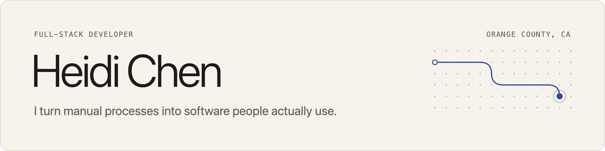
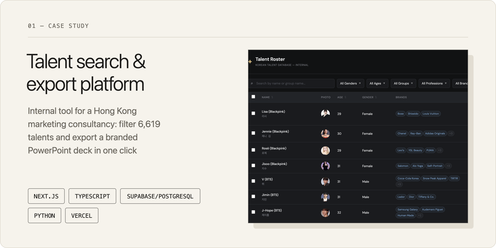
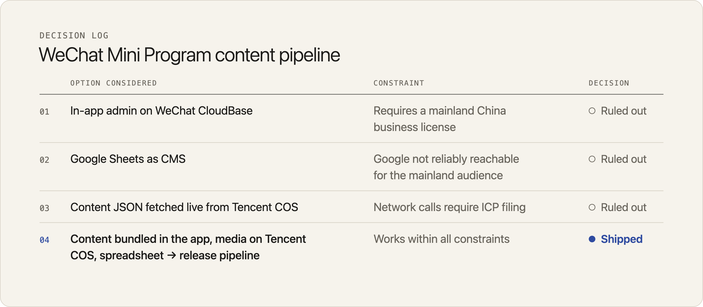

<picture>
  <source media="(prefers-color-scheme: dark)" srcset="assets/banner-dark.png">
  
</picture>

 

I scope, design and ship software for non-technical clients, solo from first conversation to production. Before freelancing, I spent three years as a Full Stack Development Instructor at Coding Dojo, teaching classes of about 30 people (most with no tech background) and debugging whatever they built. I'm originally from Hong Kong and work in English and Chinese.

## How I work

**Structure first, then code.** I build with Claude Code. It writes most of the code; I own the architecture, the data model and the tradeoffs, and I review every change before it ships. Years of debugging AI-generated student projects taught me that AI without a plan just gets you to the wrong place faster.

**Constraints are design inputs.** When a platform, budget or audience rules an option out, I change the design instead of forcing a workaround. The [decision log](#wechat-mini-program-portfolio) below shows one case.

**Plan for failure.** My data pipeline checkpoints and resumes long runs, writes idempotently so a re-run never duplicates rows, and stops on repeated errors. My media tooling never touches the original files.

**Build for whoever looks after it next.** I start by sitting with the client to learn how they work today. I finish by handing over things they can run without me: naming guidelines, a storage tool they manage themselves, a release schedule they can plan around.

## Projects

<a href="https://github.com/heidi1105/talent-filtering-demo">
  <picture>
    <source media="(prefers-color-scheme: dark)" srcset="assets/project-talent-dark.png">
    
  </picture>
</a>

The client built talent proposals by hand, copying from Wikipedia, fan sites and Instagram into PowerPoint one slide at a time. I studied her past proposals, then built:

- **A Python data pipeline** that harvests about 16,400 Wikidata records and curates them down to 6,619 talents. It adds follower counts through Bright Data and adds brand affiliations through AI enrichment, each with a confidence score and a cited source. Covered by 103 pytest tests.
- **A Next.js app** on a normalized PostgreSQL schema, with server-side filtering and a one-click export into the client's own PowerPoint template.

**[Code →](https://github.com/heidi1105/talent-filtering-demo)** · Live demo is invite-only; email me for access.

### WeChat Mini Program portfolio

A portfolio app for a Hong Kong client, shipped in about a month: UI design, media storage, sharing and go-live support. The hard part was the architecture. The client's audience is in mainland China, and her company is not, which ruled out three standard approaches:

<picture>
  <source media="(prefers-color-scheme: dark)" srcset="assets/decision-log-dark.png">
  
</picture>

**The tradeoff I accepted:** bundling the content means every content update needs a new app release. I made that predictable with a bimonthly release schedule (plus patch releases for urgent fixes) and Node.js tooling that turns the client's spreadsheet into a release. The tooling compresses media with Sharp and ffmpeg, uploads it to Tencent COS, and regenerates the content index.

## Tools

**Languages:** JavaScript, TypeScript, Python, SQL, Java, C# 
**Front end:** React, Next.js, Tailwind CSS, HTML/CSS, WeChat Mini Programs 
**Back end and data:** Node.js, PostgreSQL/Supabase, MySQL, REST APIs, Flask, Spring Boot 
**Delivery:** Git/GitHub, Vercel, pytest, Tencent COS

B.S. in Computing, The Hong Kong Polytechnic University

## Contact

[LinkedIn](https://www.linkedin.com/in/heidi115) · heidi1105@gmail.com
